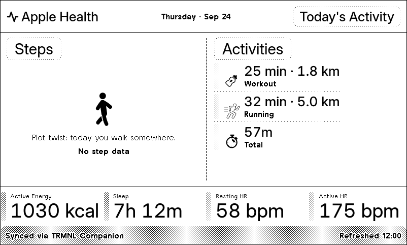
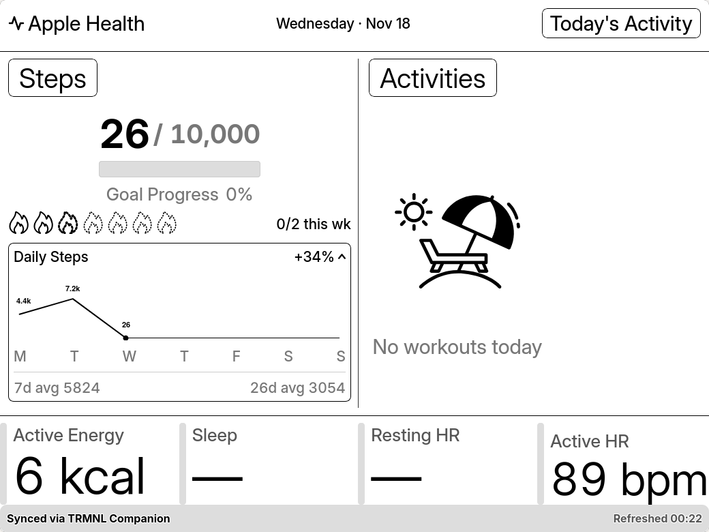
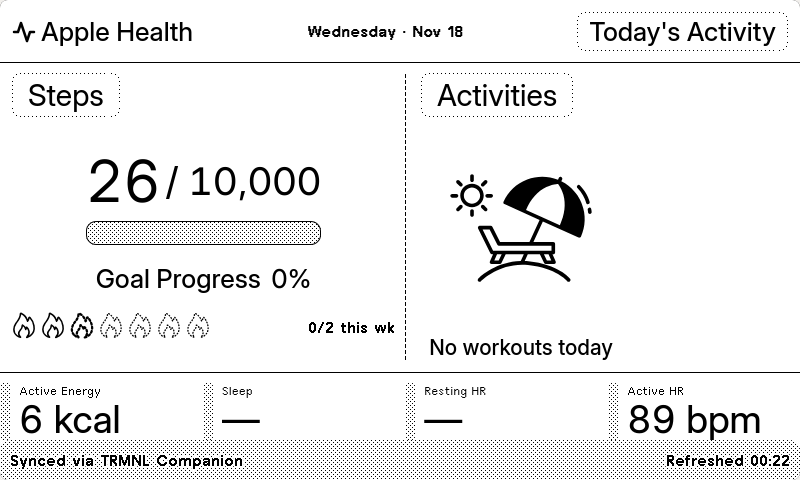
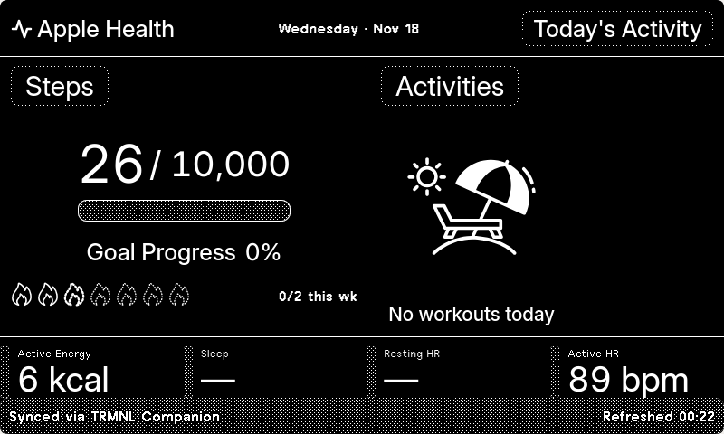

# Apple Health for TRMNL

An [Apple Health](https://www.apple.com/ios/health/) plugin for [TRMNL](https://usetrmnl.com) — steps, active energy, sleep, resting/active heart rate, and today's workouts on your e-ink display.

Shown on the display: today's steps against your daily step goal (10,000 by
default), a row of flames for this week's goal streak, workouts, and a bottom
row of active energy, sleep, resting and active heart rate. A share of screen
refreshes shows a Health Trends view (this week vs last week) instead.

| playlist |
| --- |
|  | 

| e-ink | e-ink (dark) |
| --- | --- |
|  |  |

## How it works

- **Strategy: webhook.** The [TRMNL Companion app](https://usetrmnl.com/companion) (iOS) reads Apple Health via HealthKit and POSTs the raw payload — `{ health: { metrics: [...], workouts: [...] } }` — to this plugin's webhook URL on each sync.
- **`Serverless`** reduces that raw payload into the merge variables the views use: deduplicates overlapping multi-source samples (iPhone + Watch double-counting), windows everything to the user's local calendar day via `trmnl.user.utc_offset`, and computes derived stats (max heart rate during activity, resting HR from overnight samples, total active energy across background + workout streams).
- **`Liquid Templates`** render four sizes — `full`, `half_horizontal`, `half_vertical`, `quadrant` — sharing common logic and hand-drawn monochrome icons.
- A rolling **history of daily totals** (about four weeks) is kept in TRMNL's per-install state store (`trmnl.state`), written each sync. It feeds the Health Trends view and the step-goal streak. A day nobody synced on is filled in by the next sync.

## Settings

- **Daily step goal** — steps per day the progress bar and streak count toward. Blank means 10,000. Changing it re-judges past days in the streak.
- **Trends view percentage** — share of screen refreshes (0-100) that show the Health Trends view instead of today's dashboard. 0 never shows it, 100 always does. Blank means 25.
- **Debug: send raw payload** — for troubleshooting only, **Off** by default. When `On`, each sync sends your raw Apple Health data (metrics and workouts, not your name or device details) to the developer's debug endpoint, where it is kept for 1 hour and then deleted. Leave it Off normally.

## Step-goal streak

Under the Steps card, seven flames show this calendar week (Monday to Sunday):

| Flame | Meaning |
| --- | --- |
| Solid | goal reached |
| Outline | a day that passed below the goal |
| Faint outline | a day that passed with no steps recorded (no sync), counted as neither hit nor miss |
| Bold dotted | today, goal not reached yet |
| Thin dotted | day still to come |

Beside the flames, `Streak 3d · 0/1 this wk` reads as: a 3-day streak, and 0 goal days hit out of 1 day judged so far this week. The streak counts consecutive goal days back from today (or from yesterday while today is still open). It can run back past Monday into earlier weeks, and a miss or a day with no sync ends it. When the streak is 0 that part is hidden. The half vertical view and the TRMNL X quadrant show the same line.

## Sleep

- Sleep belongs to the day you **wake up**: a 22:30-06:30 night is counted once, on the morning it ends, not split at midnight.
- The Companion app sends sleep as plain time segments without sleep stages, so the plugin cannot see awake time directly. It estimates awake stretches inside the latest night from steps, active energy and heart rate (if higher than resting) and leaves them out, so the figure can differ from the Health app's Time asleep by a few minutes.

## How to Setup

This plugin has no polling URL or API key — Apple Health data only reaches TRMNL through the [Companion app](https://apps.apple.com/us/app/trmnl-companion/id6752111280) (iOS), which reads HealthKit on-device and pushes it to this plugin's webhook.

1. **Install TRMNL Companion** from the App Store, and sign in with your TRMNL account.
2. **Install the plugin in TRMNL** enable **Webhook** strategy.
3. **Grant Health permissions.** In Companion, pull down on the Plugins tab to refresh, then select this plugin. Health data types appear in a dropdown — enable the ones you want shared (steps, heart rate, sleep, active energy, workouts, etc.); each can be toggled independently.
4. **Background sync** happens automatically after that — but per TRMNL's own docs, it can pause if you force-close the Companion app, and HealthKit background delivery isn't guaranteed to be frequent.

### Regular sync via Apple Shortcuts

For a more reliable, predictable sync cadence than background delivery alone, set up a scheduled Shortcuts automation that explicitly triggers a sync:

1. Open the **Shortcuts** app → **Automation** tab → **New Automation**.
2. Choose a **Time of Day** trigger (e.g. daily at a fixed time) — other trigger types are available if you want a different cadence.
3. Add the **Sync to TRMNL** action from TRMNL Companion to the automation.
4. Optionally disable "Ask Before Running" / notifications for this automation so it runs silently in the background.

This is the same mechanism TRMNL recommends for [keeping Calendar plugins in sync](https://help.trmnl.com/en/articles/12294875-trmnl-companion-for-ios) more frequently than passive background sync alone — it applies equally to Health.