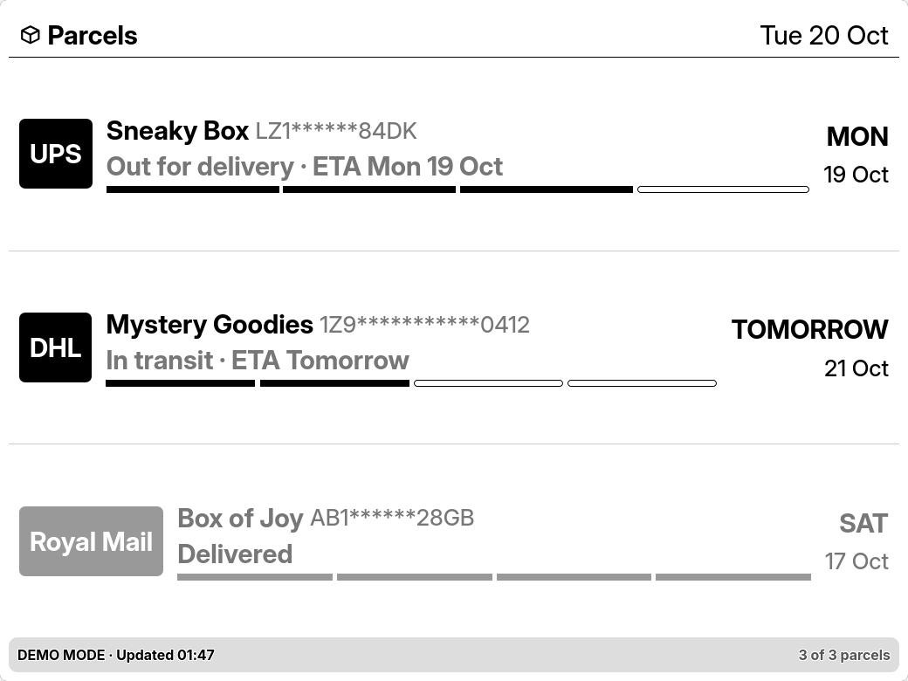
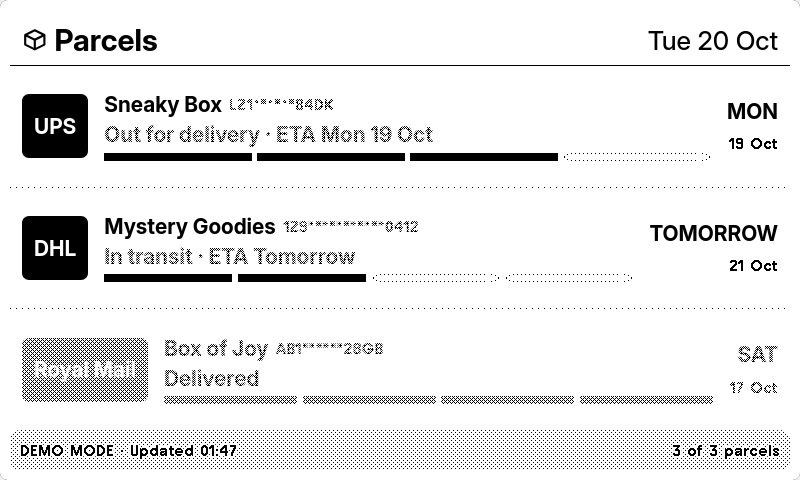
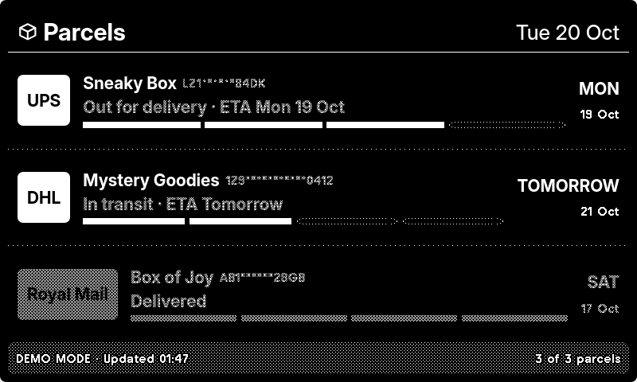
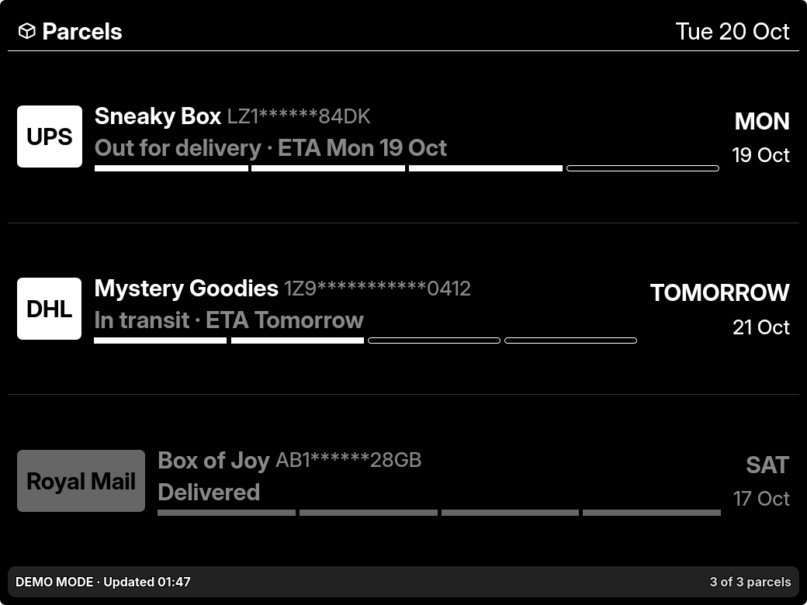
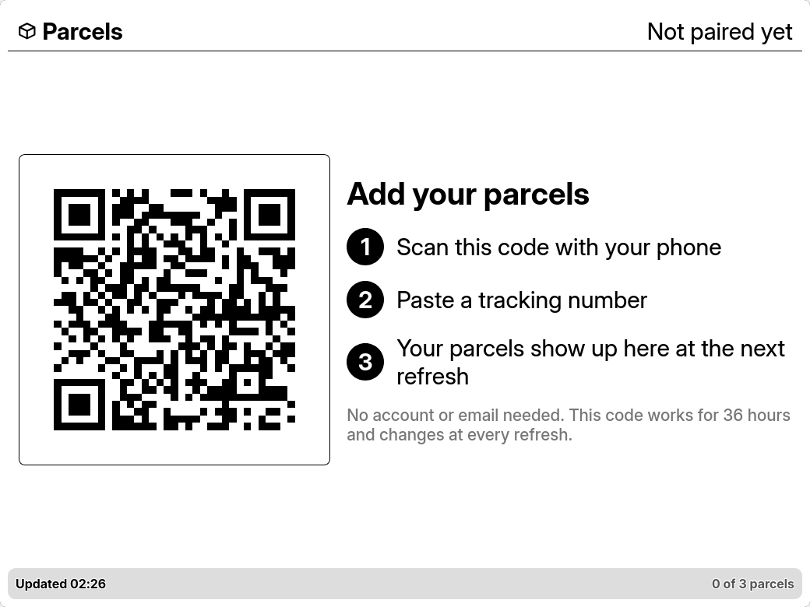
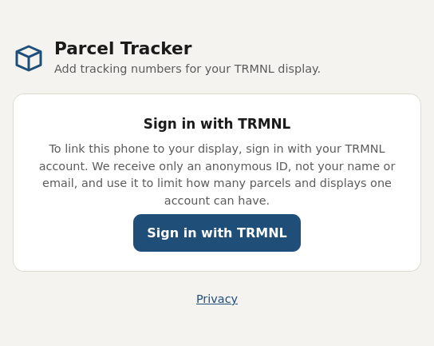
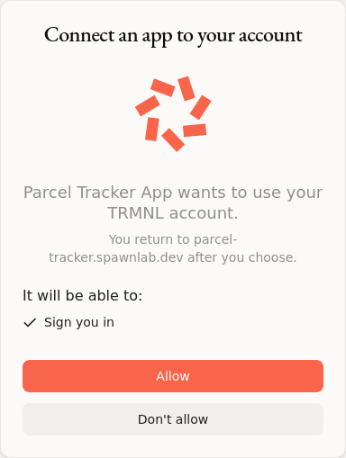
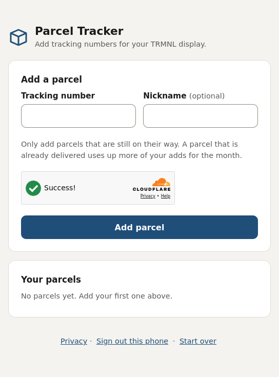
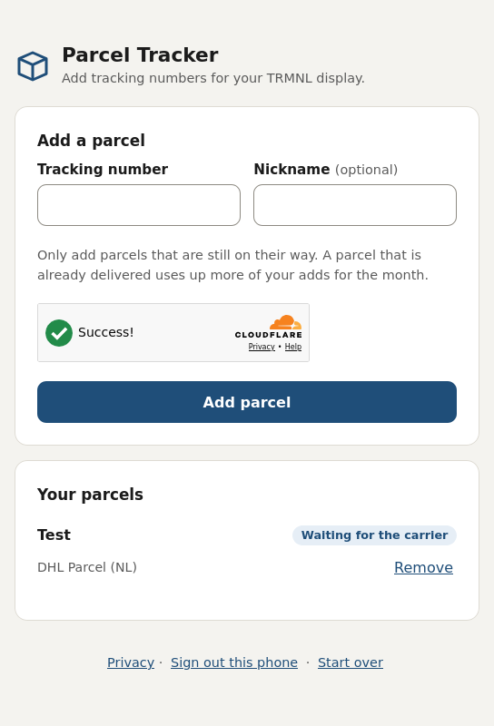
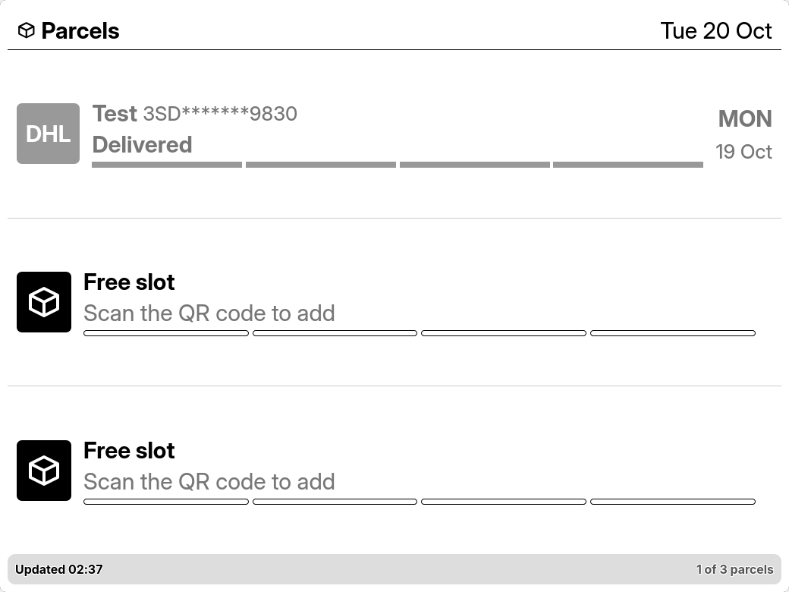

# Parcel Tracker for TRMNL

A [TRMNL](https://usetrmnl.com) plugin that shows where your parcels are, on your e-ink display. Add a tracking number from your phone and the display does the rest.

Shown on the display: each parcel's label, carrier, status and expected delivery date, with the most urgent parcel first. Scan the QR code on the display with your phone to add or remove parcels.

| TRMNL OG | TRMNL OG (dark) |
| --- | --- |
|  |  |

| TRMNL X (dark) |
| --- |
|  |

Every layout size is supported, on both TRMNL X and TRMNL OG.

## What you get

- **Live status** for each parcel: registered, in transit, in customs, out for delivery, delivered, or a problem that needs your attention.
- **Add from your phone.** Scan the QR code, type or paste a tracking number, give it a label if you like. The carrier is detected from the number.
- **No sign-up for the plugin.** No email, name or address is asked for, and the tracking number alone decides the carrier and status.

## How to Setup

1. **Install and add the plugin** to a playlist in TRMNL.
2. **Scan the QR code** on the display with your phone. It is shown whenever the list is empty.

   

3. **Sign in with TRMNL** on the phone page when asked. It only tells the service which TRMNL account the display belongs to, so the fair-usage limit can be applied. The name and email of your account are not shared.

    

   

4. **Add a tracking number.** Enter it, confirm the check if one appears, and tap **Add**.

   

5. Done. The parcel appears on the display on its next refresh, and its status updates as the carrier reports progress.

   

   

### Settings

| Setting | What it does |
| --- | --- |
| **Show QR code** | Keeps the QR code on the display next to your parcels. By default it is only shown while the list is empty. Anyone who can see the display can scan it, so leave it off in a public place. |

### Fair usage

Tracking each new number uses up a limited quota at the tracking provider, so the free plugin has fair-usage limits:

- Up to **3 new tracking numbers a month** for each TRMNL account, shared across all its displays.

Adding a number that is already tracked is free and not counted. A parcel that is already delivered when you add it can **use up more of your monthly adds**. Delivered parcels free up a slot, but they don't give back the monthly adds they used.

### Statuses

| Status | Meaning |
| --- | --- |
| Registered | The carrier knows about the parcel but has not collected it yet. |
| In transit | On its way. |
| In customs | Held at, or going through, customs. |
| Out for delivery | With the courier for delivery today. |
| Delivered | Handed over. |
| Needs attention | The carrier needs something from you, or delivery failed. |

### Refresh

The display refreshes on the schedule TRMNL sets for the plugin. Parcel status is checked about every 30 minutes and updated as soon as the carrier reports a change, so the display can show news a little before or after the carrier's own site.

## Stopping and starting over

On the phone page, **Sign out this phone and start over** removes the phone's link to the display and frees a display slot on your account. It does not reset your monthly adds.

## Credits and privacy

- Tracking data comes from a third-party parcel tracking service.
- Only the tracking numbers and labels you add are stored, tied to a random display id and, when you sign in, a one-way hash of your TRMNL account id. See the [privacy notice](https://parcel-tracker.spawnlab.dev/privacy.html).
