# Daily Workout Planner for TRMNL

A [TRMNL](https://usetrmnl.com) plugin that puts a fresh workout on your e-ink display every day. Skip the planning. Just train.

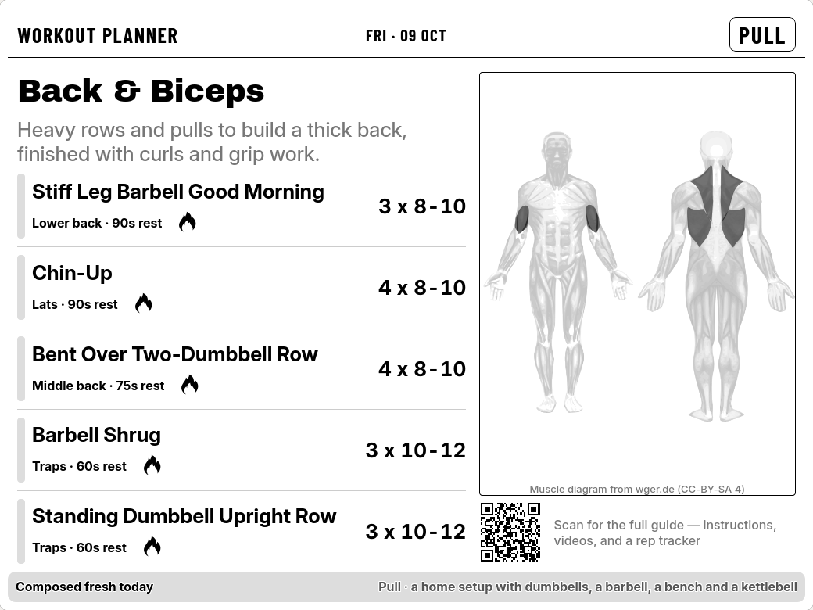

Shown on the display: today's workout with five exercises, their sets and reps, rest time and difficulty, plus a muscle diagram of what you are training. Scan the QR code on the display for the full guide with instructions, form videos and a rep tracker.

| TRMNL OG | TRMNL OG (dark) |
| --- | --- |
| 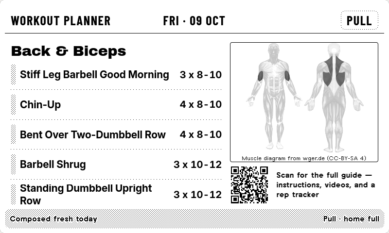 | 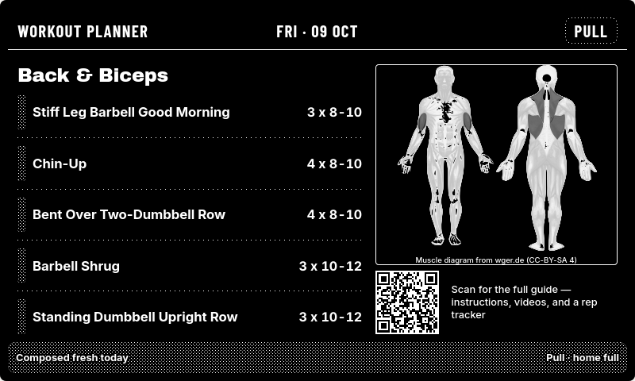 |

| TRMNL X (dark) |
| --- |
| 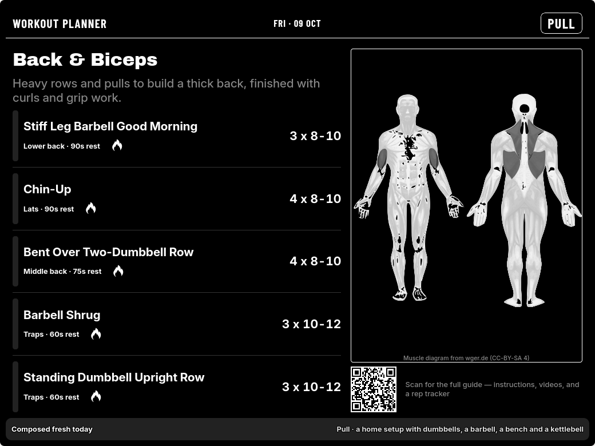 |

Every layout size is supported, on both TRMNL X and TRMNL OG:

| layout | TRMNL X | TRMNL OG |
| --- | --- | --- |
| half horizontal | 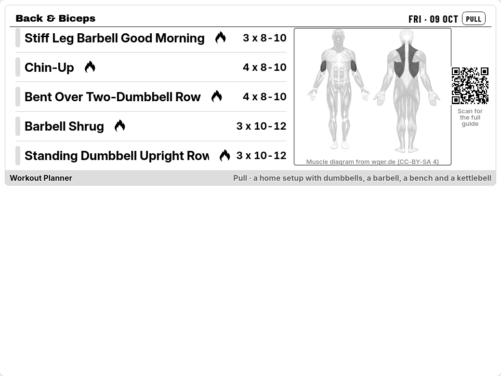 | 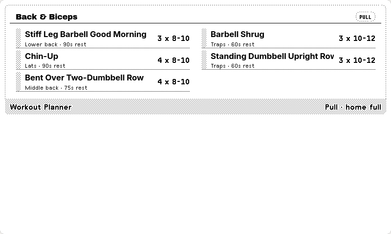 |
| half vertical | 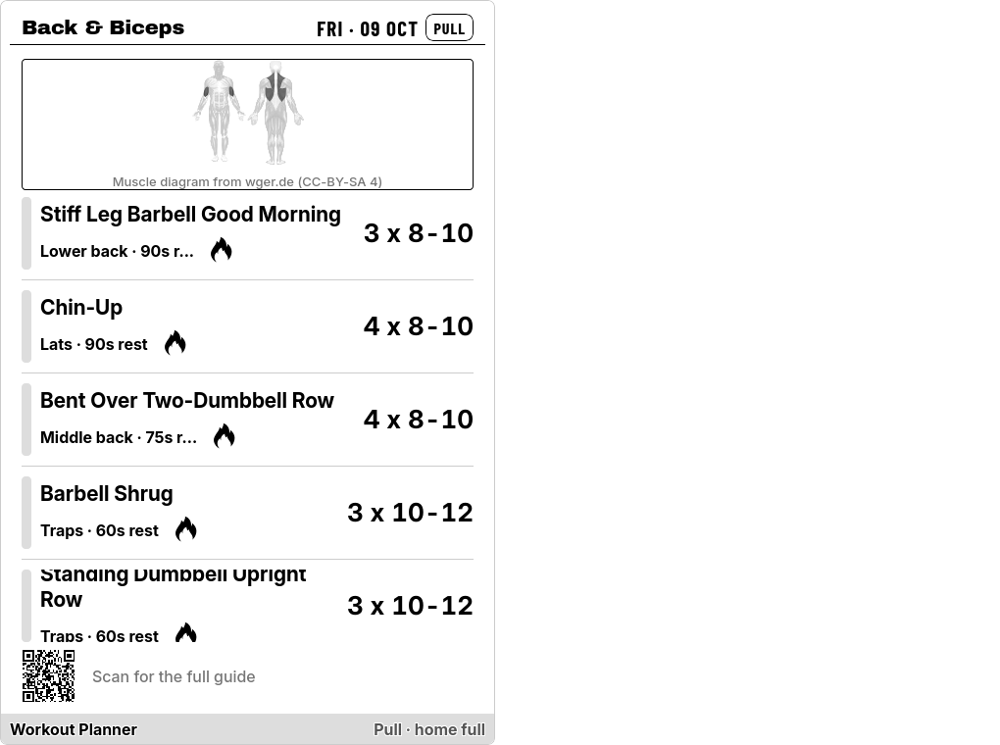 | 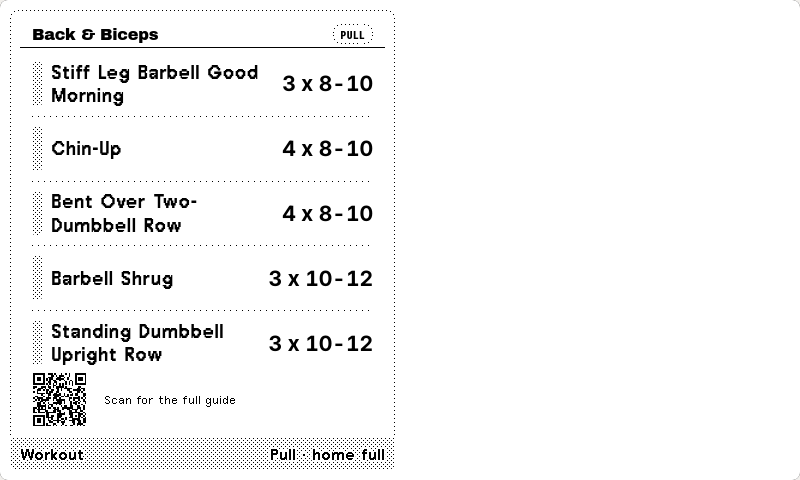 |
| quadrant | 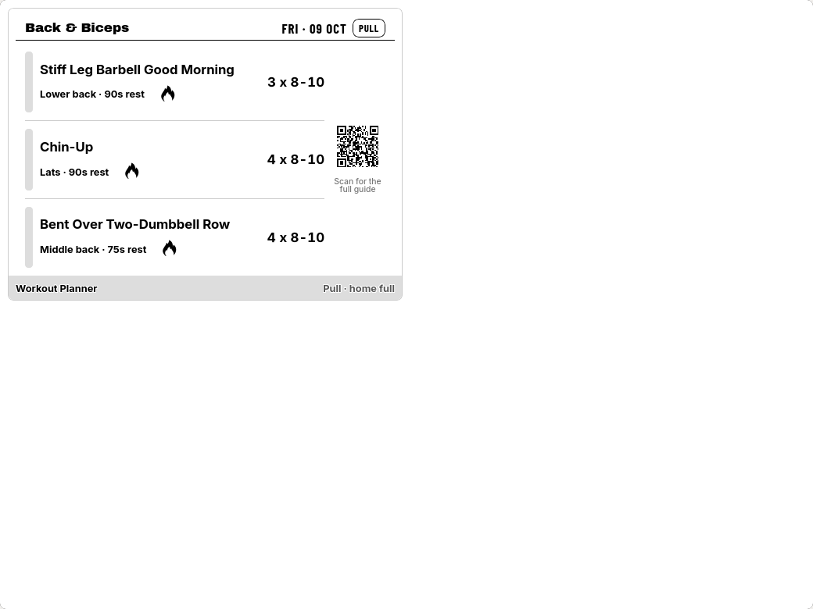 | 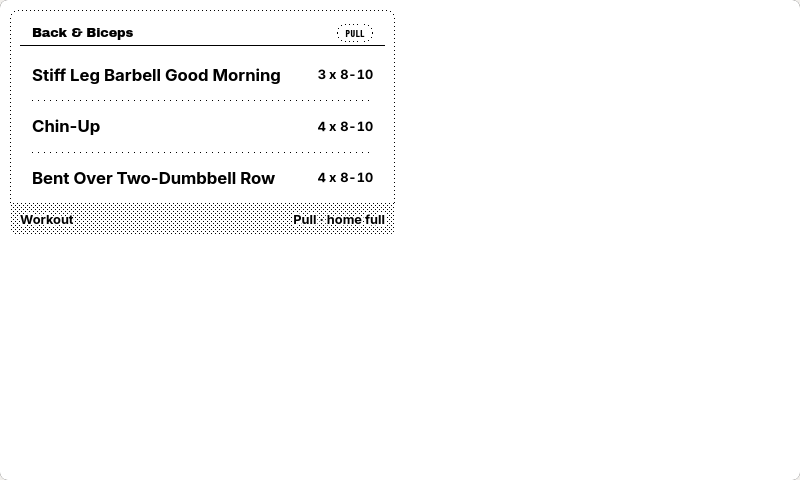 |

## What you get

- **A new workout every day** for the gym, for home, or for bodyweight only, with pull-up bar exercises if you have a bar.
- **A weekly schedule** that picks the right workout for each day. Rest days show a short recovery checklist instead.
- **Variety.** The plan avoids repeating what you did in the last week.
- **A muscle diagram** that shows which muscles today's workout trains.
- **Form videos and a rep tracker**, one QR scan away.
- **All four layouts**, on TRMNL OG and TRMNL X, in landscape and portrait.
- **Or your own plan.** Run your own private openGym tracker and show *its* plan for today on the screen: see [Use your own openGym plan](#use-your-own-opengym-plan).

## Workouts

Push, Pull, Legs, Full body, Core, Fat burn, and Stretch & mobility.

## How to Setup

1. **Add the plugin** to a playlist in TRMNL.
2. **Pick a schedule** (see below).
3. **Pick your equipment**: Gym, Home, or Bodyweight only. For Home, also choose what you have: dumbbells only, or dumbbells + barbell + bench + kettlebell.
4. **Pull-up bar** (Home and Bodyweight only): switch on **I have a pull-up bar** to add pull-ups, hanging raises and dips. The gym already has one, so the switch is hidden there.
5. **Accept the health notice** (required): under **Health disclaimer**, choose **I understand and accept**. The plugin shows no workouts until you do, and the screen tells you so.
6. Done. A new workout appears each day, following your TRMNL account's time zone.

### Health notice

The workouts are general fitness information, not medical advice. See a doctor if you have a condition or an injury, and stop if you feel pain or dizziness. You must accept this in the plugin settings before any workout is shown; until then the display asks you to accept it. The same notice appears in the plugin's About text.

### Schedules

| Schedule | Training days |
| --- | --- |
| Push / Pull / Legs, 3 days *(default)* | Mon, Wed, Fri |
| Push / Pull / Legs + Core, 4 days | Mon, Tue, Thu, Fri |
| Push / Pull / Legs, 6 days | Mon to Sat (Sunday off) |
| Full body, 3 days | Mon, Wed, Fri |
| Custom week | You choose |

Days that are not training days are rest days.

### Custom week

Choose **Custom week** and fill in **Week plan** with seven entries, Monday to Sunday, separated by commas. Use `push`, `pull`, `legs`, `full_body`, `core`, `burn`, `stretch`, or `rest`.

```
push,pull,legs,rest,push,pull,rest
```

Use the same workout seven times for one routine every day.

## Use your own openGym plan

Instead of a generated workout, the screen can show **today's workout from your own openGym tracker**: the routines you built, with the sets and reps you set. You get a private tracker of your own, signed in with your TRMNL account (we receive only your TRMNL account ID, never your email), and the plugin reads today's plan from it.

> Every picture below is a placeholder until a real screenshot replaces it. See [`docs/onboarding`](docs/onboarding/README.md) for the list.

**What you need:** a TRMNL account and about five minutes. No password is created for you: you choose your own on your tracker.

### Step 1. Get your tracker

1. Open **[setyard.app](https://setyard.app)** and choose **Sign in with TRMNL**.

   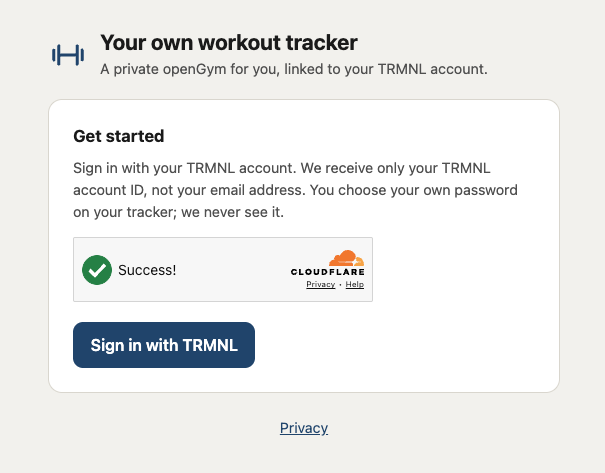

2. Approve the sign-in on TRMNL's own page.

   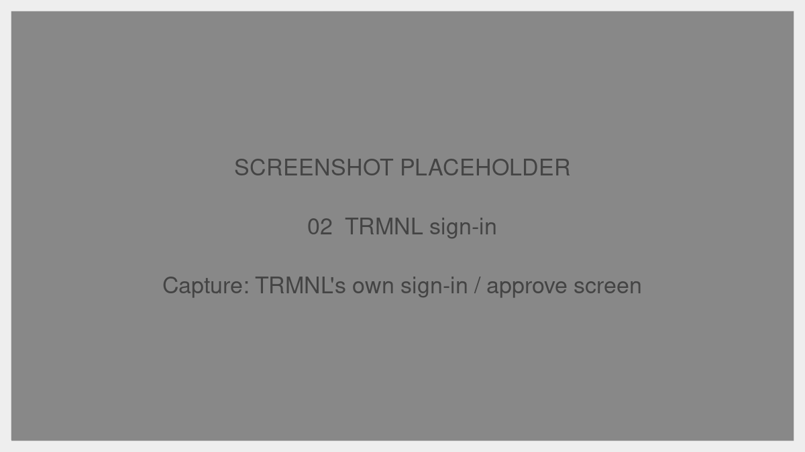

3. Wait while your tracker is built. This usually takes under a minute. You can leave the page open.

   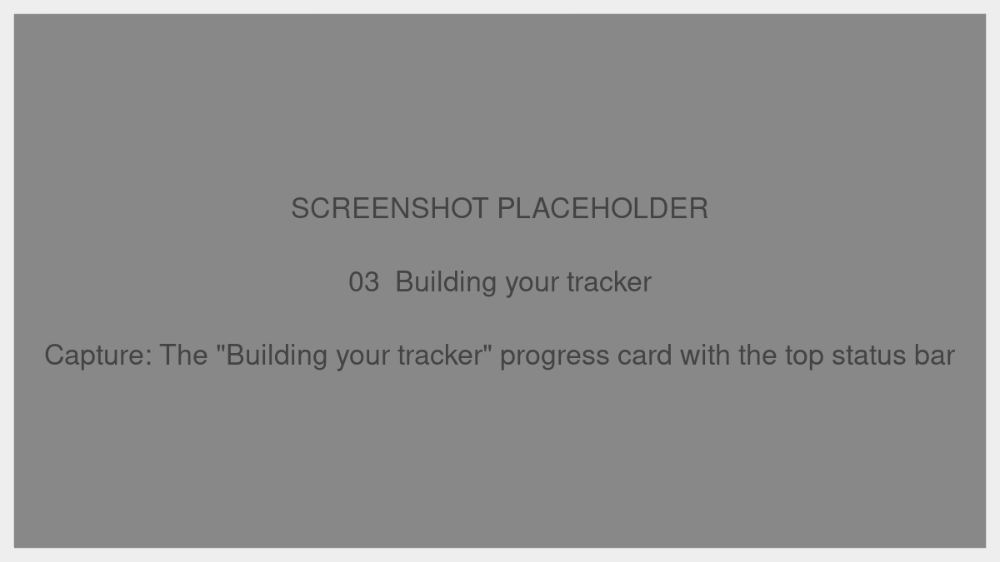

4. When it says **Your tracker is ready**, the bar at the very top shows how it is doing:

   | Indicator | Meaning |
   | --- | --- |
   | **Online** and *Up 3h 12m* (green) | Your tracker is answering. The time is how long it has been running. |
   | **Starting up** (amber) | It is still being built or restarting. Wait a moment. |
   | **Paused** (grey) | It has been switched off. Contact the operator to turn it back on. |
   | **Not responding** (red) | It is not answering. Try again in a minute; if it stays red, contact the operator. |
   | **Status unknown** (grey) | The page could not check right now. Reload in a moment. |

   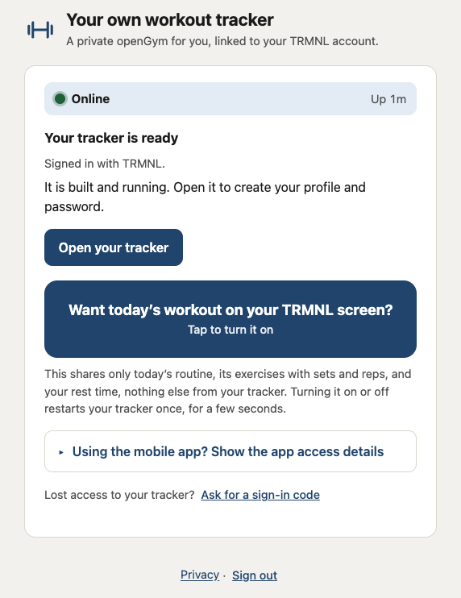

### Step 2. Create your profile

1. Choose **Open your tracker**. A fresh private link is made every time, and it works for a few minutes.
2. On your tracker's first screen, create **your profile and password** (or a passkey). The first profile becomes the owner, and the tracker is closed to anyone else, so keep the password safe.

   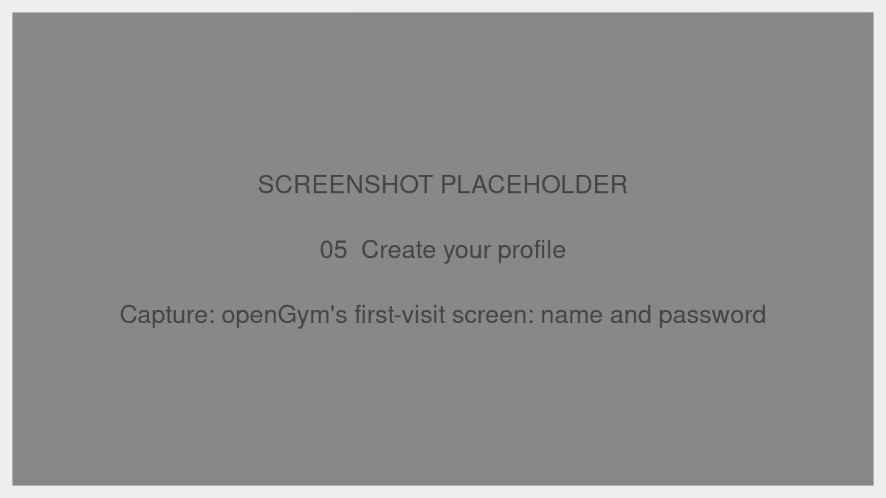

### Step 3. Plan your week

In your tracker, open **Plan**, create your routines and give each one a weekday. Days with no routine count as **rest days**, and the screen shows a short recovery checklist for them (and tells you what is on tomorrow).

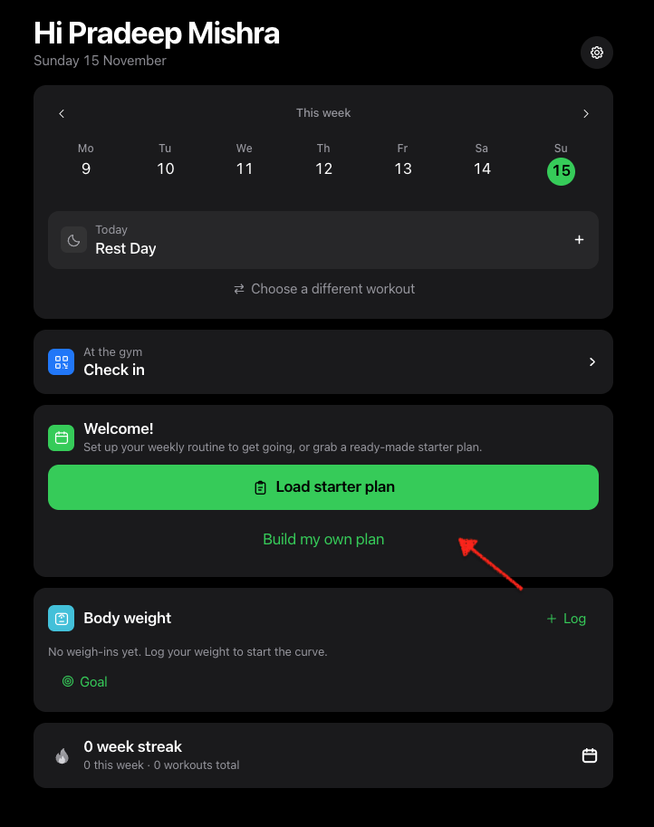

### Step 4. Send today's workout to your TRMNL screen

Back on **setyard.app**, find the big button **Want today's workout on your TRMNL screen?**

1. Tap it to turn it on. Your tracker restarts once, for a few seconds, and the plan reaches TRMNL within a minute or two.

   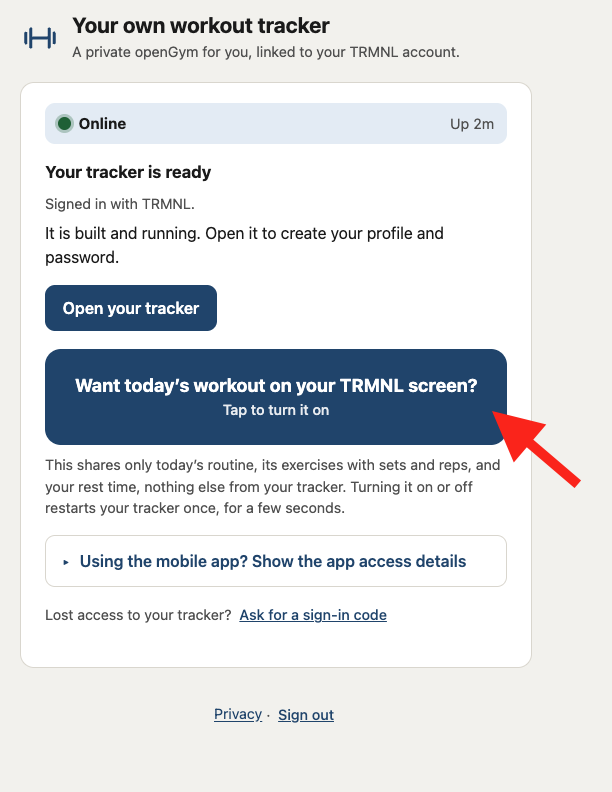

2. When the button turns **green** ("Today's workout is on your TRMNL screen"), your **plan key** appears below it. Choose **Copy**.

   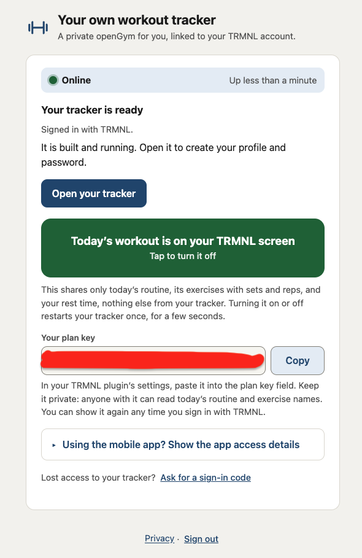

   Keep the key private: anyone with it can read today's routine and exercise names. It is not shown while the switch is off, and you can show it again any time you sign in with TRMNL.

### Step 5. Set up the plugin

1. Add **Daily Workout Planner** to a TRMNL playlist (see [How to Setup](#how-to-setup)).
2. Set **Workout source** to **My openGym plan**.
3. Paste your **plan key**.
4. Under **Health disclaimer**, choose **I understand and accept**.

   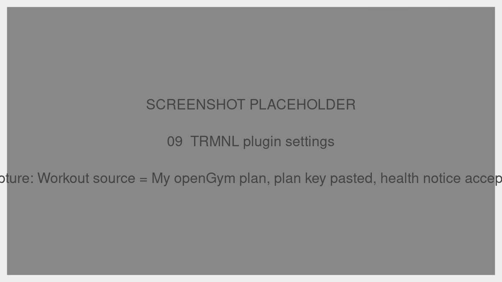

### Step 6. See it on your screen

Today's routine appears with its exercises, sets and reps, muscles and rest time, a muscle diagram of what you are training, and a one-line summary.

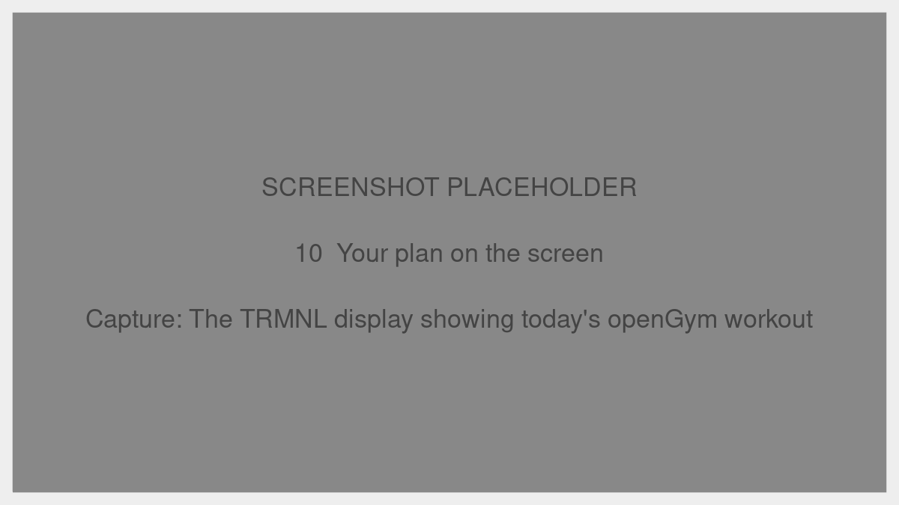

On a rest day you get the recovery checklist and a note about tomorrow.

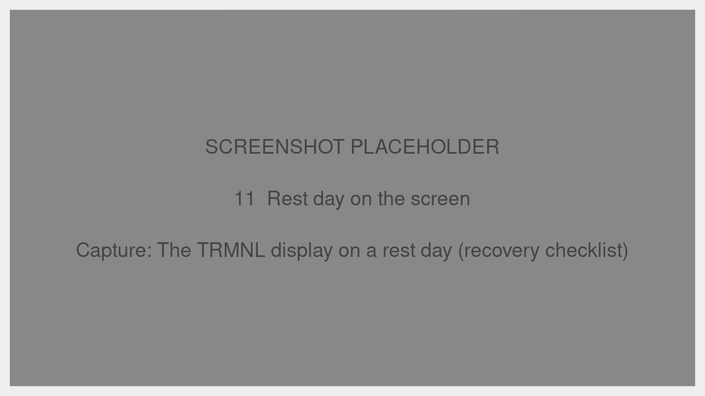

### What is shared with TRMNL

Only today's routine name, its exercises with sets and reps, your rest time, and the name and muscles of any exercise you made yourself. Nothing else leaves your tracker: no notes, weights, body measurements, history or password. Turn the button off any time: the tracker stops sending and TRMNL's copy expires within about a day and a half.

### Optional: the mobile app

The openGym mobile app signs in with two values from the page. Open **Using the mobile app? Show the app access details**, then **Copy** the **Client ID** and **Client Secret** into the app's two Cloudflare Access fields. Keep the secret private.

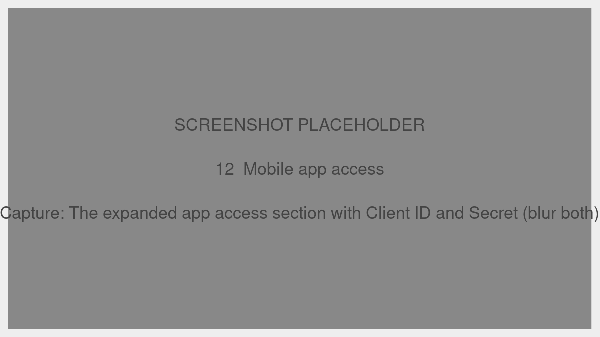

### Optional: the AI Coach

Your tracker has an AI Coach that designs a plan and revises it from what you log. It is off until you connect an AI provider of your own with your own key (**Settings, Account, Admin dashboard, AI Coach**). When you use it, your logged sets and notes go to the provider you chose, and you agree to that first on a consent screen. Plans it makes show up on your screen like any other.

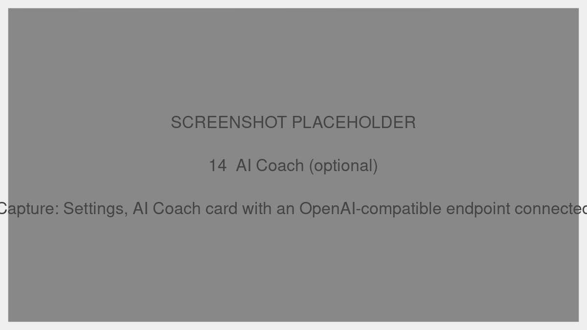

### Troubleshooting

| You see | What to do |
| --- | --- |
| The screen says **Open the openGym app** | Today's plan has not reached TRMNL yet. Check the green switch on setyard.app is on, then open your tracker once and wait a minute or two. |
| **Accept the health notice to start** | In the plugin settings, choose **I understand and accept** under Health disclaimer. |
| The summary line reads "From your openGym plan." | The one-line summary is made after the first refresh. It appears on its own within a few minutes. |
| The top bar says **Not responding** | Reload after a minute. If it stays red, contact the operator. |
| You lost access to your tracker | Sign in with TRMNL on setyard.app again and choose **Ask for a sign-in code**. Send the reference it shows to the operator in a direct message. They reply with a one-time code that works once and expires in 24 hours. On your tracker's sign-in screen choose **Lost access?** and then **I have a code**. |

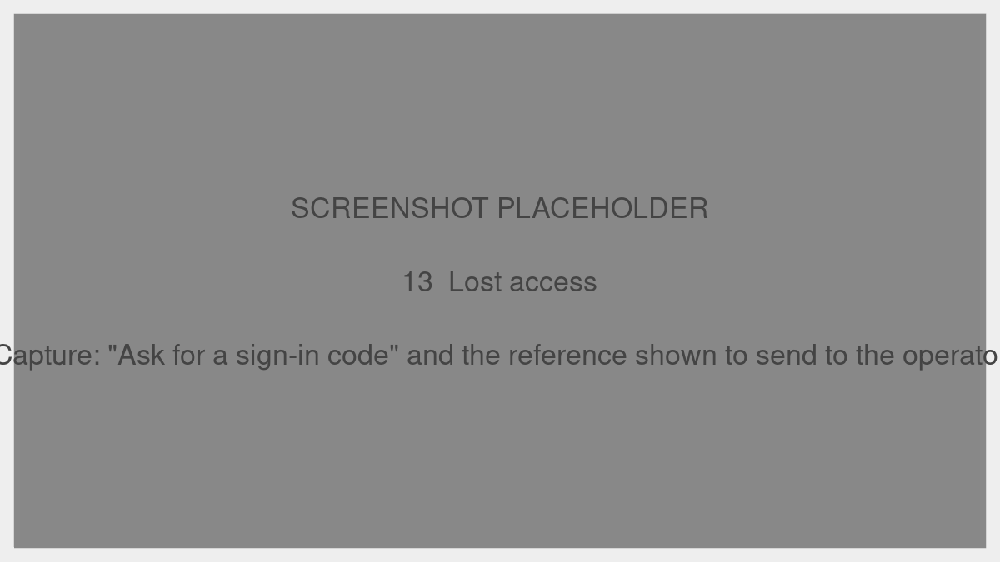

## Credits and privacy

- **Huge thanks to [openGym](https://opengym.ch)** by Duarte Santos, the open-source gym and body-weight tracker (AGPL-3.0, [source on GitHub](https://github.com/DuarteSantos8/openGym)) that makes the "Use your own openGym plan" option possible. Your private tracker *is* openGym, and its exercise catalogue and muscle map also power the names and muscle diagram of your own plan. If you like it, go give it a star, and get the app at [opengym.ch](https://opengym.ch).
- Exercise data comes from the [Free Exercise DB](https://github.com/yuhonas/free-exercise-db) (public domain).
- The muscle diagram is built from artwork by [wger.de](https://wger.de), licensed [CC-BY-SA 4.0](https://creativecommons.org/licenses/by-sa/4.0/); the credit is shown on the display.
- The generated workouts need no account or sign-up. The openGym option uses your TRMNL account ID only (no email) and is opt-in. See the [privacy notice](https://w.spawnlab.dev/privacy).
